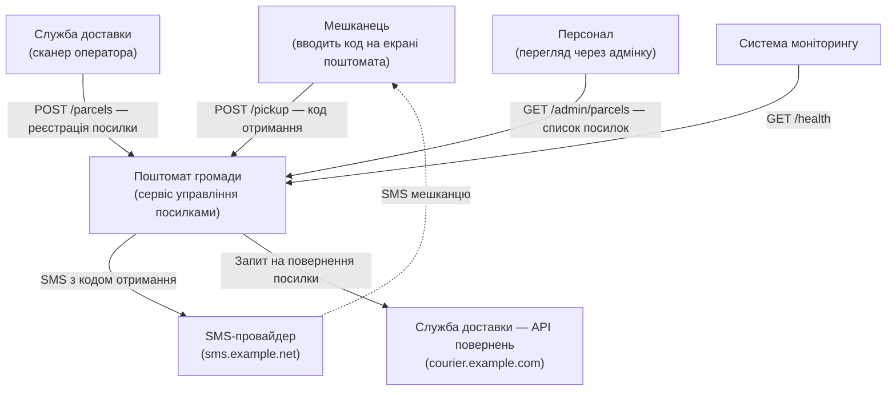
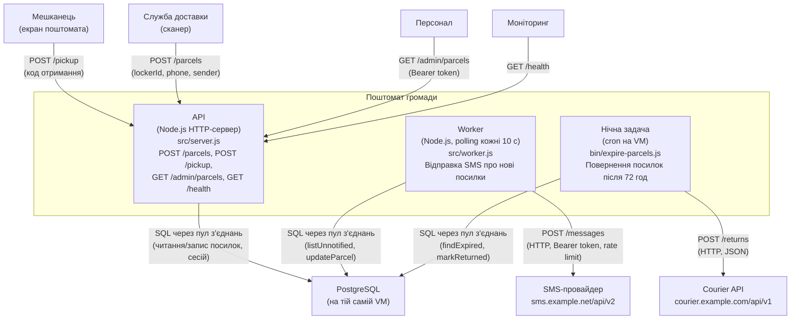

- Інструмент і модель: Claude Code, Claude Opus 4.6
- Дата: 2026-10-23
- Що бачила сесія: тимчасова тека `../ws11-b-code/` з копією `app/`
- Промпт (дослівно):

  > Намалюй архітектуру цієї системи як C4-діаграми в Mermaid:
  > рівень System Context і рівень Container.
  > Відповідь дай повністю в чаті; файлів не створюй і уточнювальних питань не став —
  > припущення називай явно.

---

Я проаналізував код у `app/` — усі модулі в `src/`, `bin/` та конфігурацію. Ось діаграми.

## Припущення

1. PostgreSQL працює окремо від застосунку — в коді (`src/db.js`) реалізовано пул з'єднань з обмеженням `max` і тайм-аутом, а `src/config.js` читає `DATABASE_URL` з оточення. У самому репозиторії база — in-memory заглушка, але інтерфейс ідентичний.
2. SMS-провайдер — зовнішній HTTP API (`src/sms.js`): `POST {baseUrl}/messages`, авторизація через `Bearer` токен, rate limiting з повторами при 429.
3. Служба доставки (courier) — зовнішній HTTP API (`src/courier.js`): `POST {baseUrl}/returns` для повернення посилок.
4. Екран поштомата — це клієнт, який звертається до API (`POST /pickup`); у коді немає прямого зв'язку з апаратним забезпеченням поштомата.
5. Моніторинг опитує `GET /health`, але в коді він не реалізований як окремий компонент — я показую його як зовнішню систему.

## Рівень 1 — System Context

## Рівень 2 — Container

## Ключові спостереження з коду

- **API і Worker використовують спільний образ** — у `package.json` є `start` (server) і окрема команда для worker.
- **Пул з'єднань** (`src/db.js`) обмежений параметром `DB_POOL_MAX` (за замовчуванням 4); при перевищенні — `PoolTimeoutError` → HTTP 503 «service busy».
- **Worker** працює в polling-режимі: кожні 10 секунд (`POLL_INTERVAL_MS`) бере батч до 50 записів (`BATCH_SIZE`), відпускає з'єднання з пулу, і лише потім надсилає SMS.
- **SMS-клієнт** (`src/sms.js`) самостійно дотримується rate limit (`ratePerSec`) і робить до 4 повторів із експоненційним backoff при 429.
- **Нічна задача** — окремий процес (`bin/expire-parcels.js`), запускається через cron, а не через API чи worker.
- **Автентифікація** адмінки — через `Authorization: Bearer <session>`, сесії зберігаються в БД.
- **`GET /health`** не потрапляє до access log і не потребує автентифікації.
- **Heap monitoring** — `watchHeap` у `server.js` кожну хвилину перевіряє використання heap і логує попередження при ≥75%.
