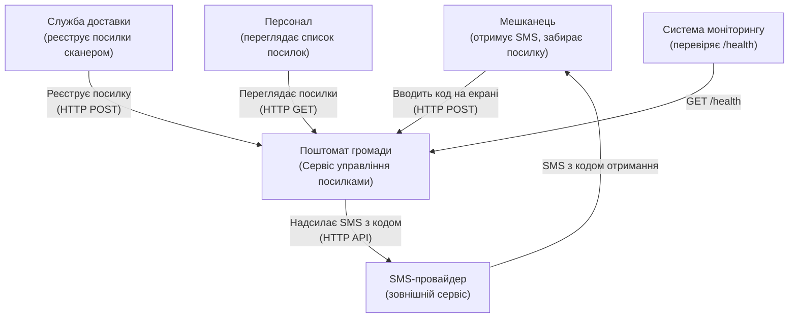
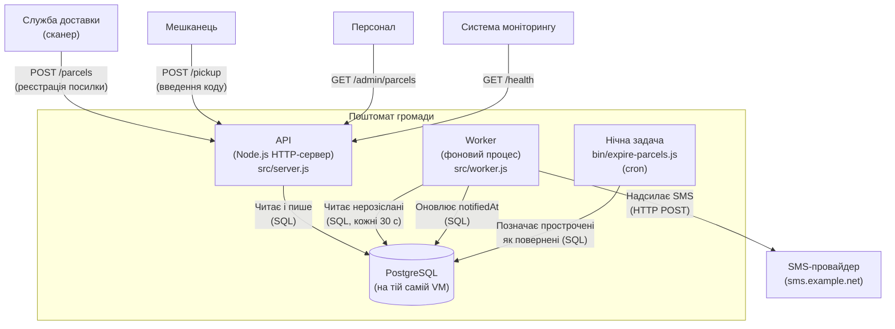

- Інструмент і модель: Claude Code, Claude Opus 4.6
- Дата: 2026-10-23
- Що бачила сесія: тимчасова тека `../ws11-b-docs/` з `app/README.md` та `app/docs/`
- Промпт (дослівно):

  > Намалюй архітектуру цієї системи як C4-діаграми в Mermaid:
  > рівень System Context і рівень Container.
  > Відповідь дай повністю в чаті; файлів не створюй і уточнювальних питань не став —
  > припущення називай явно.

---

## Припущення

1. Документація описує продакшн-середовище — PostgreSQL як основну базу даних.
2. Екран поштомата — це окремий клієнт, який звертається до API по HTTP.
3. Служба доставки використовує сканер, що також надсилає HTTP-запити до API.
4. SMS-провайдер — зовнішній сервіс, до якого worker звертається по HTTP API.
5. Персонал працює з адмінкою через HTTP API (ендпоінт `/admin/parcels`).
6. Моніторинг опитує `/health` — це може бути зовнішня система або внутрішній інструмент.

## Рівень 1 — System Context

## Рівень 2 — Container

## Короткий опис потоку

1. **Реєстрація:** служба доставки сканує посилку → `POST /parcels` → API генерує 6-значний код і зберігає в PostgreSQL.
2. **Сповіщення:** Worker кожні 30 секунд перевіряє базу на нові посилки без сповіщення → надсилає SMS з кодом через SMS-провайдера → оновлює `notifiedAt`.
3. **Отримання:** мешканець вводить код на екрані поштомата → `POST /pickup` → API знаходить посилку за кодом і позначає як видану.
4. **Закінчення терміну:** щоночі `expire-parcels.js` позначає посилки старші за 72 години як повернені відправнику.
5. **Адмінка:** персонал дивиться список через `GET /admin/parcels` (номери телефонів маскуються, коди не показуються).
