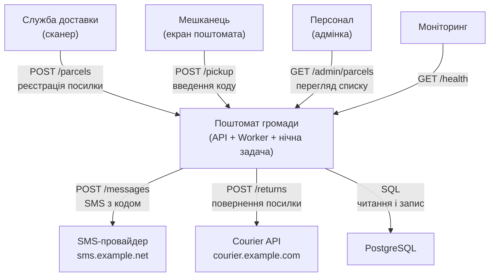
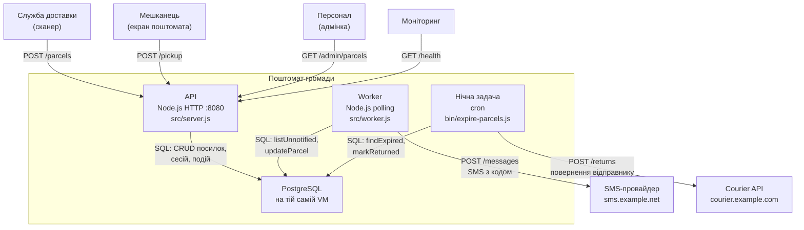

# Архітектура «Поштомата громади» — C4

## Рівень 1 — System Context

## Рівень 2 — Container

## Стрілки і докази

| # | Стрілка (звідки → куди: що і як) | Доказ (`файл:рядок`) | AI з документації (`ai-runs/c4-from-docs.md`) | AI з коду (`ai-runs/c4-from-code.md`) |
|---|---|---|---|---|
| 1 | Служба доставки → API: POST /parcels, реєстрація посилки | `app/src/server.js:39` | є | є |
| 2 | Мешканець (екран) → API: POST /pickup, введення коду | `app/src/server.js:42` | є | є |
| 3 | Персонал → API: GET /admin/parcels, перегляд списку | `app/src/server.js:47` | є | є |
| 4 | Моніторинг → API: GET /health | `app/src/server.js:37` | є | є |
| 5 | API → PostgreSQL: CRUD посилок, сесій, подій | `app/src/server.js:93` (createPool), `app/src/parcels.js:43` | є | є |
| 6 | Worker → PostgreSQL: читає невідправлені, позначає надісланими | `app/src/worker.js:24` (listUnnotified), `app/src/worker.js:33` (updateParcel) | є | є |
| 7 | Worker → SMS-провайдер: POST /messages, SMS з кодом | `app/src/sms.js:31` | є | є |
| 8 | Нічна задача → PostgreSQL: findExpired, markReturned | `app/bin/expire-parcels.js:13–14` | є | є |
| 9 | Нічна задача → Courier API: POST /returns, повернення відправнику | `app/src/courier.js:7`, `app/bin/expire-parcels.js:15` | пропустив | є |

## Що AI вигадав / пропустив

| Прогін | Вигадав — стрілки й компоненти, яких у коді немає (і чим це перевірили) | Пропустив — стрілки з таблиці вище, яких немає в AI |
|---|---|---|
| з документації | нічого — `app/docs/ARCHITECTURE.md` не згадує зайвих компонентів | #9: нічна задача → Courier API — `ARCHITECTURE.md` не згадує сервіс courier; `grep -ni courier app/docs/ARCHITECTURE.md` нічого не знаходить |
| з коду | нічого — усі компоненти і зв'язки підтверджені кодом | нічого — AI з кодом знайшов усі 9 стрілок |

**Разом:** з документації — вигадано 0, пропущено 1; з коду — вигадано 0, пропущено 0.
